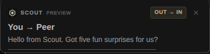

Scout now has a small place in my Omarchy bar and a way to show incoming and outgoing messages while I work. Getting there took a few days of using it, noticing what felt awkward, and asking for another pass.

The starting request was simple: an Omarchy app for Scout, starting very small. By Sunday, I was asking for denser LED gauges and little floaters in the top-right corner. Somewhere between those two requests, Linux support became a product design exercise.

This is the work from October 8 through 11 on Archie, my Linux machine. Some of it is installed locally. Some has landed as reviewed source. The new usage treatment is still a design study. That distinction matters when the process produces something attractive faster than it produces a release.

## Give it a place to live

We started with Scout's existing web interface. The launcher asks the running broker to start its web server, then opens or focuses a dedicated Scout window. Repeated launches reuse that window.

That was enough to make the first version useful. I could launch Scout from Omarchy's application menu and get back to it without finding a browser tab or remembering a local address.

Then came the desktop details: transparency, a button in the bar, and a popup with service status, recent activity, and provider usage. Scout's Mac menu app gave us a useful list of things to borrow.

The visual direction took a few attempts. We tried warm accents and rounded cards, tightened everything, and eventually made the Scout mark use the exact foreground color of its neighboring bar icons. On the next pass, the window corners followed this desktop's square treatment, and the popup adopted Omarchy's shared colors, fonts, and borders.

I also wanted the menu to appear on the monitor where I was working. A perfectly rendered popup on the virtual monitor is still a missing popup.

[Omarchy encourages this kind of desktop customization](https://omarchy.org/). For this work, its existing shell and plugin surfaces gave us somewhere to put Scout without building a whole Linux desktop application first.

## Make the menu answer useful questions

The first menu accumulated features quickly. Broker memory, uptime, peers, activity, quotas, shortcuts, appearance settings. It needed a clearer reason to exist.

The redesign began with the questions I actually have during a work session:

- Does anything need me?
- What is running?
- How much capacity do I have left?
- What just finished?
- Are my other machines available?

Those questions became the **Now, Work, Usage, Machines, and Tools** views. New task and Open Scout stay available across the menu. A work row leads to the work; an activity row leads to its conversation.

That also forced some labels to become more precise. A discovered agent is not necessarily working. A trusted machine is not necessarily connected. An old quota reading needs its age, and an unavailable reading needs to look different from zero.

The bar menu reads Scout's existing CLI, which keeps the display grounded in the broker's records. That constraint helped the design: when the data was unreliable, we kept the uncertainty visible.

## Find the Mac assumptions underneath

The desktop work exposed ordinary platform assumptions too. On October 10, Scout's local HTTPS edge was still trying to launch macOS's `dns-sd` on Linux. Its installation advice suggested Homebrew, and its certificate lookup expected a Mac directory.

We added an Avahi publishing path for Linux, looked for Caddy's local certificate authority in the XDG data directory, and checked trust against the system certificate store with OpenSSL. The installation hint now uses the package manager present on the machine.

One particularly irritating delay came from name resolution. Publishing an IPv6 loopback record along with the IPv4 record removed the wait for an unanswered AAAA lookup on this host. Getting both local hostnames resolving and serving trusted HTTPS made the doctor's readiness report meaningful again.

The same investigation found a separate problem with forwarded work. An invocation arriving from another machine could refer to message and work records that existed only on its sender. Those absent rows caused foreign-key failures in the receiving machine's SQLite projection. The fix preserves the invocation and leaves those optional local references empty when their parents are absent.

These were concrete fixes with local verification. Broader installation work and testing across other systems still remain.

## Let me see the conversation

On October 11, I asked for notifications for both inbound and outbound communication, with controls for each.

The implementation is a small observer running as its own user service. It follows the local broker's live event stream and hands notifications to Omarchy. It does not create conversations or launch agents. Starting it does not replay old messages across the desktop.

The Tools view now has switches for incoming messages, outgoing messages, attention alerts, and message previews. I can choose all communication or just messages involving me. Changes apply to subsequent events while the observer is running. It also has a rate limit and remembers message identifiers to avoid duplicate alerts.

Then I asked to say hello to arts-mini and get five surprising, fun statements back. The outgoing notification appeared in desktop history, but I saw no floater.

Do Not Disturb was on.

That was a useful correction to our verification. The desktop had accepted the notification. It had deliberately kept it off-screen. After I chose to turn off Do Not Disturb, we checked the actual popup on the actual display.

The remote request had a separate state: it was accepted and still marked “waking” when we checked. We had no verified reply to display. To try the two directions without inventing one, we added a repeatable preview:

```bash
scout-notifications test roundtrip
```

It shows an outgoing card followed by an incoming card. Both are labeled as previews, respect the direction settings, and use the same native notification path. The command sends no Scout messages.

## Give the floaters some care

Once I could see both cards, I wanted them to be prettier and more thoughtful.

The current treatment separates the pieces I need to scan: a small Scout header, an **OUT → IN** or **IN → OUT** badge, the sender and recipient, and the message preview. Outgoing cards use a restrained amber accent; incoming cards use sage. A preview has its own label. The border stays quiet, and the close control is easy to find.

These are captures of the two native preview cards:




The little expiry line uses the notification service's existing clock. Hovering pauses that clock, as it does for the native card. Clicking opens the related Scout view; right-clicking dismisses the alert.

We installed the presentation in a user-owned clone of Omarchy's notification plugin. Other applications keep their original card, and the native service still handles history, Do Not Disturb, actions, and lifetime.

One final wrinkle: the notification service stays loaded across plugin hot reloads. Switching to the new presentation needed a shell restart. The first test after that restart was too early for the D-Bus notification service, so we waited for readiness and tried again. Both directions then rendered correctly. We needed to check the desktop result as well as the file we changed.

## Make usage feel like an instrument

The usage view prompted a different request: more compact, with an LED gauge, progress rail, or bar-chart treatment. I asked to do it in a Studio study first.

We compared three directions at the menu's actual widths. The first pass still had too much air. The second put all five quota windows into five 28-pixel rows, with the gauge, exact capacity percentage, and reset time aligned on each line.

The LED version uses twenty cells. A number remains beside it because the cells are a quick visual estimate. Filled and hollow markers distinguish fresh and cached readings without depending on color. Missing capacity gets a dash and a striped gauge; exhausted capacity gets 0% and an empty gauge. Clicking a row reveals its source and capture time.

The dense study is about 275 pixels tall, down from about 517 in the earlier LED pass. We checked it at both 448 and 320 pixels wide.

This is still a fixture-backed study. It uses a frozen local snapshot plus synthetic pressure and missing-data states, and it has not replaced the installed QML usage view. That gives us something specific to judge before changing the live menu.

## Keep using it

The sequence worked because each request came from the desktop in front of me. Launch it. Open it again. Match the neighboring icons. Put the popup on this monitor. Show the outgoing message. Make the usage view denser.

Agents could inspect the existing pieces, implement a bounded change, and bring back a render or a test result. My part was to keep trying it and say when the result still felt wrong. The best corrections were often small and quite literal.

Scout on Omarchy is a local developer pilot today. The launcher and menu are useful here; the notification observer and polished cards are running here; the compact usage direction is ready for an implementation pass. We still have packaging, updates, and wider Linux verification to do.

I already want the little Scout mark in my bar when I sit down to work. That feels like a good place to build from.

## Public source

The optional [notification observer, controls and cards](../linux-desktop.md)
now live in public Scout. The [portable usage study](../../examples/linux-usage/README.md)
runs without the private Studio and uses synthetic fixtures. The original local
quota capture is not part of that public example. The launcher and full bar
menu described here remain local customizations; the compact usage study has
not replaced the installed QML view.
