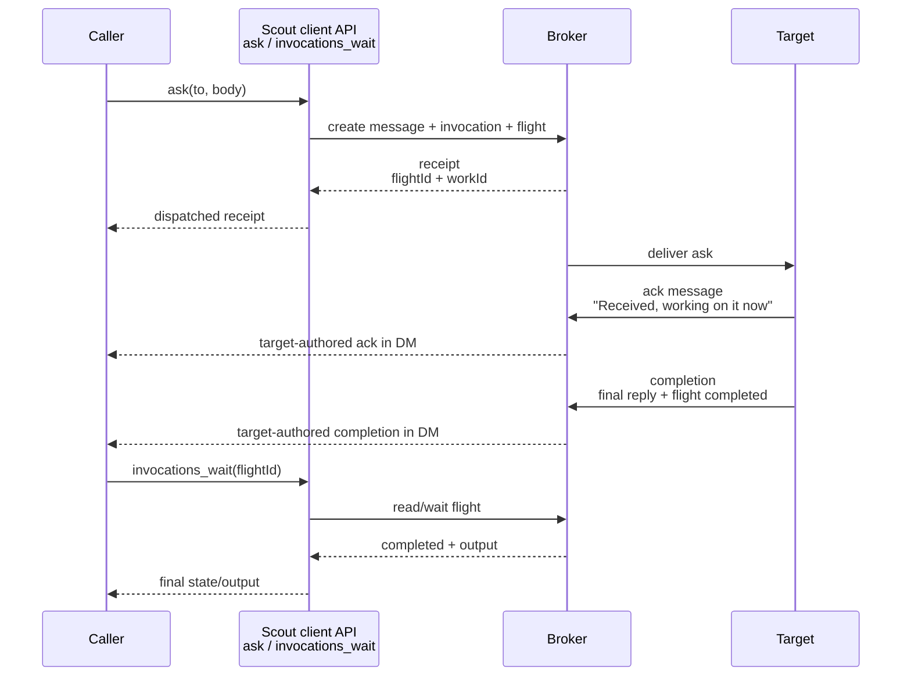
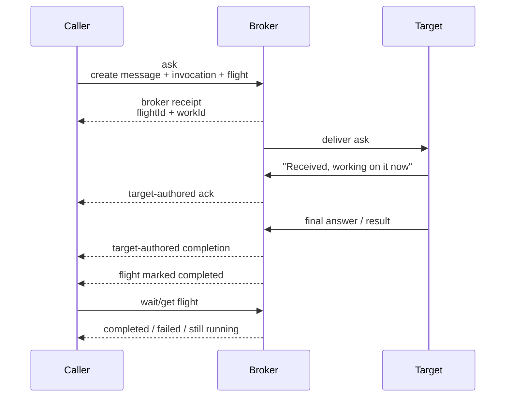

# Scout Comms

## Inspect work and contact the operator

Use `scout status <handle>` to inspect a flight, invocation, work item, question,
message, or `ref:` binding without waiting. To triage all work visible to the
current broker:

```bash
scout status --all
scout status --all --blocked
scout status --all --failed
scout status --all --blocked --next-actor operator --json
scout status --all --blocked --next-actor self --json
```

`--blocked` selects explicit waiting/review states and unanswered questions. It
never guesses from silence, inactivity, or words such as “blocked” in a message.
Each result carries its stable handle, source state, reason, next actor when
known, and a suggested next action. A runtime read failure is an error, not an
empty list. `--all` means the current broker snapshot; it does not poll every
remote machine, inspect uncaptured native harness prompts, or promise historical
records beyond the runtime's retained snapshot. No additional age cutoff is
applied. Related work items and flights remain separate records with their own
handles. Reading status never acknowledges, dismisses, retries, or resumes work.

An operating agent may deliberately contact the operator whenever a user-defined
condition is satisfied, independently of turn completion:

```bash
scout ask --operator --fyi --notify "The screen is ready for review." --image ./screen.png
scout ask --operator --fyi --notify "The investigation found a reason to change our plan."
scout ask --operator "Which environment should I use?" \
  --option staging --option production
scout ask --operator "May I deploy this migration to staging?" --permission
```

The operating agent evaluates the condition. An operator FYI creates no task.
An operator question creates a human-owned task, tracked until answered,
expired or cancelled. `--permission` adds metadata, not permission to act.
`--default-action "X"` lets the asker proceed; if unanswered at the deadline
(default 1800 seconds; `--window` overrides it), the task completes as
`proceeded with default`. A late answer is delivered as a marked follow-up.

Operator questions always request a push. Defaults request normal priority.
FYIs request no push unless `--notify` is present. Notification policy is
stored on the task or FYI message and enforced by APNs. App attention-center
adoption follows the core release.

Receipts distinguish durable recording from notification delivery, which remains
best-effort and unconfirmed. macOS consumes explicit signals while Scout is
running, with a persisted delivery cursor; initial installation starts with new
signals rather than replaying history. Remote iOS push carries generic text and
opaque message/conversation references. Open Scout for the authored content.
There is no image embedded directly in the remote push payload. PNG/JPEG/GIF/WebP
images up to 25 MiB use the local runtime's authorized message/blob binding.
They do not require a pairing file server. Image availability follows broker
blob retention; `imageExpiresAt` is `null`, not a six-hour promise. A protected
broker can impose a smaller upload-request limit. Reading images requires a
client that supports canonical blob references. Text remains in the durable
conversation. See [operator image attachments](./operator-image-attachments.md)
for the write contract and failure behavior.

The former public commands `need` and `attention` are retired. Use
`ask --operator`, `status`, and `diff` for their distinct purposes.


This is the front door for building a Scout-aware client, plugin, or adapter.
Read this when you want to understand how Scout interactions work: what gets
routed, what gets stored, how replies find their way home, and which pieces are
display affordances rather than protocol authority.

Scout comms are **not an HTTP spec**, but they are not not like one:

- an interaction has an intent, like a method
- it has routing context, like headers
- it has a body, which remains payload
- it returns durable ids and state, like a receipt/status surface
- it may create follow-on records such as flights, questions, or work items

The important difference is that the local runtime, not a wire format, is the
canonical writer for Scout-owned coordination state. Product surfaces should
treat a **Chat** as the user-facing place where messages live; the runtime and
protocol currently store that place as a **Conversation** with a
`conversationId`. For the Chat invariants and migration rules, read
`concepts.md`.

## Current Posture

Scout is for high-trust local developer environments. Treat these docs as current
integration guidance, not a frozen public API guarantee. Do not build claims
around enterprise readiness, compliance readiness, hardened multi-tenancy, or
exactly-once distributed delivery.

## Mental Model

Scout has three layers:

| Layer | What It Does |
| --- | --- |
| Protocol | Shared TypeScript shapes for messages, invocations, conversations, delivery, reply context, and collaboration records |
| Broker | Local source of truth that resolves targets, writes records, plans delivery, and tracks asks |
| Surface | CLI, desktop, web, mobile, harness plugin, or external client that reads/writes through the runtime |

A client should submit structured intent to the runtime and render runtime-owned
records back to the user. It should not infer routing from message body text.

## Core Records

| Record | Meaning | Primary Type |
| --- | --- | --- |
| Chat / Conversation | A durable place messages belong: DM, channel, group DM, thread, or system lane. Chat is the public product noun; Conversation is the internal broker/protocol record. | `ConversationDefinition` |
| Message | A durable body posted by one actor into one conversation | `MessageRecord` |
| Delivery | A planned transport-specific fan-out for a message or ask | `DeliveryIntent` / `ScoutDeliverRequest` |
| Invocation | An explicit request for an agent to do something | `InvocationRequest` |
| Flight | The lifecycle of an invocation: queued, running, waiting, completed, failed, or cancelled | `FlightRecord` |
| Reply context | The active return path when a harness is answering an inbound broker ask | `ScoutReplyContext` |
| Question | Lightweight information-seeking collaboration record | `QuestionRecord` |
| Work item | Durable owned execution record with progress, waiting, review, and done states | `WorkItemRecord` |
| Binding | Link between a Scout conversation and an external channel/thread | `ConversationBinding` |
| Dispatch record | Routing diagnostic for ambiguous, unknown, unparseable, or unavailable targets | `ScoutDispatchRecord` |

Protocol source files live in `packages/protocol/src`.

## Runtime Sessions

Scout is also a harness runtime surface. A Scout **agent** is durable domain
identity; a **session** is an opaque `sess.*` handle resolving to a concrete
Claude, Codex, or future harness context; an **endpoint** is the current route
to that context.

Cards are identity and return-address records. They do not by themselves mean a
harness session is alive. Treat card creation, registration, and explicit
session attachment as a pro integration layer for hosts or Scout-native agents
that intentionally manage identity infrastructure. Core agents should use
`ask`, `send`, and `reply`; the runtime can create or bind cards internally when
needed. Commands that start or attach harnesses should use the public noun
**session** and should fail loudly when a requested harness cannot be backed by
a compatible session.

Examples of the intended shape:

```bash
scout session start --agent hudson --harness codex
scout session attach --agent hudson --harness codex --session <id>
scout session inspect --agent hudson --harness codex
```

`scout up` may remain as a convenience alias, but it should resolve to an
explicit session operation and report what happened. See
[`runtime-sessions.md`](./runtime-sessions.md).

## Interaction Workflows

### Deliberate FYIs

`scout ask --to <agent> --fyi "news"` (MCP `ask({to, fyi: true, body})`)
records a durable message and delivery handles, with no task or work record.
Use it only when no work, judgment or answer is expected. Channels are FYI-only:
`scout ask --channel shared --fyi "news"`. Routing stays outside the body.

### Task follow-ups and answers

Use `ask --ref <task>` to add context to unfinished work. It creates no new
task and preserves the recipient. Use `--cancel` with a reason to cancel;
text never cancels by itself. The receipt reports whether interruption was
confirmed. Finished, failed and cancelled tasks require
`ask --continue <task> "successor request"`, which starts fresh work with the
earlier outcome as context. This is distinct from active-parent `--continue-for`.

The recipient answers with `reply --ref <task> "answer"`. A final closes the
task. `--progress` updates the work record and leaves it open; `--failed`
closes it as failed. The first final wins. A cancelled task rejects a later
answer. The harness final is already an automatic answer: do not answer twice.
`reply --to <message>` is a conversation reply with no task lifecycle.

### Ask / Requested Reply

`ask` creates or updates a task through the runtime. The task owns its
invocation, flight and work record. Clients supply routing metadata, not
instructions hidden in the message body.

Use the ask path when the caller expects a reply, judgment, investigation,
review, implementation, or any owned next step. If the meaning is "do this and
get back to me," it is an Ask. When in doubt, use Ask.

Examples:

```bash
scout ask --to hudson "Review the auth module and report risks."
scout ask --project ../talkie "Review the auth module and report risks."
scout ask --project ../talkie --harness claude "Review the auth module and report risks."
scout ask --project ../talkie --runtime codex/gpt-5.6-sol/xhigh "Review the auth module and report risks."
scout ask --to hudson "Review the auth module and report risks."
```

MCP equivalent:

```ts
ask({
  to: "@hudson",
  body: "Review the auth module and report risks.",
})

ask({
  projectPath: "../talkie",
  harness: "codex",
  model: "gpt-5.6-sol",
  reasoningEffort: "xhigh",
  body: "Review the auth module and report risks.",
})

ask({
  to: "@hudson",
  body: "Review the auth module and report risks.",
  replyMode: "notify",
})
```

Asks return on acceptance by default. MCP `replyMode: "notify"` retains that
legacy spelling; it is unrelated to operator push `--notify`. Use `wait` to
follow the outcome rather than changing a task into an FYI.

### Reply Mode And Session Placement

Reply mode and session placement solve different problems:

| Choice | Controls | Default |
| --- | --- | --- |
| Reply mode | whether the caller waits inline, returns for a later notification, or does not wait | `notify` (acceptance) |
| Session placement | where a newly created harness session lives and whether its native UI can list/open it | `background` |

Ordinary Scout-routed work should use background placement. Foreground is an
explicit operator requirement for cases where they want to watch, chime in, or
continue directly in the destination harness UI. A live handoff from one
harness to another is a common foreground case: the operator may want the new
task to appear in the destination harness rather than exist only as a hidden
broker-managed worker.

Foreground placement does not mean foreground process priority, inline reply
mode, terminal attachment, or app focus. A foreground request must not open or
focus the native app without a separate operator action. If the selected
harness route cannot honor foreground placement, the client should expose that
limitation instead of silently falling back to background.

Exact runtime selection uses the separate fixed-position RuntimeSpec production
`<harness>[/<model>[/<effort>]]` or the equivalent explicit dimensions. It is
not agent identity syntax. Profiles are base presets, and legal explicit
dimensions override them. Exact runtime asks create isolated sessions; an
exact session continuation fails unless its observed tuple matches.

Expected client behavior:

- create or display a durable message for the ask
- use `projectPath` / `--project` when the project is known but the concrete
  agent or session is not; add `harness` / `--harness` when the capability
  matters. Scout resolves or creates the right project worker.
- do not teach agents to guess generic names such as `claude.main`; start from
  project + capability, then trust the broker receipt
- surface returned ids such as `flightId` and `workId`, plus any `ref`,
  `sessionId`, or broker-suggested situated target handle for follow-up
- expose friendly situated target handles as `target:<name>` for human input;
  agents and compact UI may render the same handle as `⌖name`
- treat the initial `ask` response as the broker receipt, not as the target
  agent's acknowledgement
- expect the target agent to promptly post a broker-visible acknowledgement in
  the same conversation when it starts working
- expect target-authored completion as a later message and flight completion
- use `invocations_wait` / `invocations_get` for longer follow-up polling
- inspect the invocation's `executionResolution` when exactness matters:
  requested and resolved values describe the launch decision and its source;
  observed values and drift are the harness-owned verification
- show wake/session failures as lifecycle state, not as silent background limbo

Client API shape:



Product architecture shape:



### Broker Reply Mode

When a harness is invoked by Scout, it may receive an active reply context. In
that mode, the final answer should go back through the original broker
conversation instead of creating a new send.

The reply context looks like:

```ts
interface ScoutReplyContext {
  mode: "broker_reply";
  fromAgentId: string;
  toAgentId: string;
  conversationId: string;
  messageId: string;
  replyToMessageId: string;
  replyPath: "final_response" | "mcp_reply";
  action?: "consult" | "execute" | "summarize" | "status" | "wake";
}
```

Rules:

- For `final_response`, the final assistant message is the answer. Do not also
  call a reply tool.
- For `mcp_reply`, use `reply({ref, progress: true, body})` for acknowledgement
  and progress, then `reply({ref, body})` once for the final.
- Explicit-completion tasks require `reply` for the final, after joined work
  settles. Refresh `current_reply_context` before submitting it.
- Do not create a new ask to answer the original task.
- Reuse request IDs after uncertain receipts.

### Durable Work

If the interaction needs ownership, progress, waiting, review, or done states,
represent that as a work item rather than stretching a simple ask.

Use work updates for material transitions:

```ts
work_update({
  work: {
    workId: "work-...",
    state: "working",
    progress: {
      percent: 40,
      summary: "Runtime path mapped; tests pending."
    }
  }
})
```

Questions answer information. Work items carry ownership.

## Routing Rules

- One explicit target means DM.
- The default target should be the base agent or project identity. Harness,
  profiles are durable launch policy, while harness, model, node, endpoint, and
  session details constrain or record execution rather than creating another
  agent.
- If no concrete agent/session is known, route work by project path instead of
  running discovery just to invent a target.
- Group coordination requires an explicit channel.
- Shared broadcast is opt-in.
- Message body text is payload, not routing metadata.
- Prefer explicit routing fields over body mentions.
- Preserve follow-ups in the same conversation, thread, question, or work item.
- If a target is ambiguous, fail closed or ask one concise clarification.
- If sender identity is missing, establish a stable sender binding before
  routing.
- The runtime should coach the sender with candidates, likely intent, and
  remediation commands instead of returning bare "not found" or "unavailable"
  errors when it has enough context to guide the next step.

Route aliases use this precedence: exact typed routes; explicit `alias:<name>`;
native agent id/name/selector/configured aliases; bare route alias in the
caller's current project and local node; then legacy `target:<handle>`/`⌖`
session-handle fallback. The runtime never searches every project or node for a
bare alias. `target:<name>` consults route aliases before its legacy fallback.

Alias dereference happens once at acceptance. The receipt and durable message,
invocation, flight, and work metadata retain requested alias, binding id,
revision, scope, canonical target, authority node, and resolution time. Reusing
the alias in a later call resolves its current binding; following a returned
ref/session/conversation/work handle does not re-resolve it.

Do not rely on body mentions for routing:

```ts
// Avoid: target is only text payload.
ask({ body: "@hudson can you check this?" })

// Prefer: target is explicit, body stays payload.
ask({
  to: "hudson",
  body: "Can you check this?"
})
```

## Composer Route Operator

Composers translate routes to explicit CLI flags or MCP fields. The explicit
`scout ask` parser has no positional recipient and rejects unknown flags.


Human-facing composers can use `>>` as a route operator when `@` would collide
with host autocomplete or mention systems. The operator is input sugar for
explicit routing fields; clients should strip it from the body before handing
the request to the runtime.

Typed:

```plaintext
/scout:ask >> hudson Review the parser.
/scout:ask >> ref:8kj4pd Continue from that result.
/scout:ask >> project:../talkie Compare auth.
/scout:send >> channel:ops Status is green.
```

Broker-facing shape:

```ts
ask({
  to: "hudson",
  body: "Review the parser."
})
```

The route target grammar is:

| Input | Structured Target |
| --- | --- |
| `>> hudson` | `{ kind: "agent_label", label: "hudson" }` |
| `>> agent:hudson` | `{ kind: "agent_label", label: "hudson" }` |
| `>> target:mw-talkie` | `{ kind: "target_handle", handle: "mw-talkie" }` |
| `>> ref:8kj4pd` | `{ kind: "binding_ref", ref: "8kj4pd" }` |
| `>> project:../talkie` | `{ kind: "project_path", projectPath: "../talkie" }` |
| `>> id:agent-...` | `{ kind: "agent_id", agentId: "agent-..." }` |
| `>> channel:ops` | `{ kind: "channel", channel: "ops" }` |
| `>> broadcast` | `{ kind: "broadcast" }` |

The shared parser can recognize direct agent ids for clients that pass
`targetAgentId`. CLI composer routing currently uses labels, refs, and project
paths for asks; `channel:<name>` and `broadcast` are send/update routes.

### Natural-language profile and existing-handle targets

The CLI has two deterministic natural-language forms that do not use the
composer `>>` grammar:

| Input | Structured target | Meaning |
| --- | --- | --- |
| `Fable to review this` | `{ kind: "runtime_profile", profile: "fable", projectPath: <current> }` | fresh broker-profile launch |
| `Opus high to review this` | runtime profile plus `reasoningEffort: "high"` | fresh launch with effort override |
| `agent Composer Review to fix this` | `{ kind: "existing_handle", handle: "composer-review" }` | exact existing agent/session handle |

Reserved profile names are `Fable`, `Kimi`, `Grok`, and `Opus`. The runtime,
not the client, owns their harness/model/fresh-session definitions. Direct
`ask --to fable` still means existing-target routing; it must never be
reinterpreted as a profile. The explicit profile surface is
`ask --profile fable`. Fable and Opus accept optional effort overrides; Kimi
and Grok reject effort until their ACP transports expose that control.

`agent <name> to <request>` lowercases and dash-normalizes `<name>`, then asks
the runtime for one exact handle match. Locality and fuzzy similarity are not
tiebreakers. Zero or multiple matches return disambiguation without delivery.
This exact-handle route is distinct from mutable post-hoc route aliases. An
unknown exact handle never falls through to a same-named route alias.

`target:<name>` is the canonical human-typed form for a Scout-saved situated
target: profile, project, harness, rules/tool context, and current continuation
handle. Agent-authored prompts and compact UI may use `⌖name` for the same
handle. Clients should normalize both spellings to the same structured target
before broker dispatch.

`@agent` remains valid compatibility syntax where a surface owns the text box.
For new Scout-aware composers, prefer `>>` for target entry and render the
resolved situated target with the Scout contact mark, such as `⌖mw-talkie`.

If routing cannot complete safely, a client should render the runtime's dispatch
or remediation result rather than guessing. `ScoutDispatchRecord` covers
`ambiguous`, `unknown`, `unparseable`, and `unavailable` targets, including
candidates or wake/register/retry guidance when available.

Good failure shape:

```plaintext
@hudson#codex resolved to codex-hudai.main.air-local, but no compatible Codex
session is attached. I found a Claude session for the same project.
Try: scout session start --agent codex-hudai --harness codex
```

Bad failure shape:

```plaintext
error: no explicit destination
```

## Receipts And Delivery State

A delivery receipt means the runtime accepted the request and wrote or planned
runtime-owned records. It does not mean the target read the message, completed
the task, or accepted the result.

Delivery state is layered:

| State | Meaning |
| --- | --- |
| `accepted` | local broker journaled the envelope and may still need to forward |
| `queued` | target is known, but dispatch or compatible endpoint readiness is pending |
| `waking` | Scout is starting or resuming a compatible harness session |
| `peer_acked` | remote broker journaled the envelope |
| `running` | target agent claimed the flight or work |
| `waiting` | target agent or broker is blocked on a named dependency |
| `completed` | terminal success for that delivery/flight layer |
| `deferred` | retry window is still open |
| `failed` | terminal failure with failure metadata |
| `cancelled` | cancelled before completion |

`peer_acked` is especially easy to overread. It means the remote broker has the
envelope, not that the remote agent has finished the work. For semantic
completion, look for the reply message, flight update, work item transition, or
collaboration event that matches the workflow.

For local harness-backed agents, a receipt may be followed by session wake or
attachment. Agent-card targets are fresh-session requests; historical session
records and superseded endpoint records are not candidates for ordinary card
routing. If the caller names `session:<id>`/`targetSessionId`, Scout should
continue that exact session or return a dispatch/lifecycle failure that says
"session reference not attachable" or "session not currently reachable".

The normal fresh-start workflow is therefore: capability request by
`projectPath` + optional `harness`; broker dispatch to an existing or new
compatible worker; receipt with durable ids/ref and, when available, a friendly
mnemonic handle; follow-up by that handle/ref; optional pin/name after the worker
proves useful.

## Coordination Cost

Scout should make coordination cost visible to developers and maintainers,
especially protocol overhead: the tokens Scout consumes or generates to route,
wrap, diagnose, summarize, attach, wake, or coach around a task. This should be
internal telemetry first, not a user-facing scoreboard. Keep it separate from
harness execution usage: the tokens Claude, Codex, or another model spends doing
the delegated work.

Where harnesses expose usage, broker records should preserve prompt, completion,
and total token counts linked to the relevant session, endpoint, message,
invocation, flight, or work item. Each record should label the source as
`protocol_overhead`, `harness_execution`, or another explicit category. Where
exact usage is unavailable, Scout may store estimates labeled as estimates.

Cost accounting should include the runtime's own diagnostic/coaching work when it
spends extra reasoning to avoid sender-side retry loops. This lets Scout compare
one smarter broker response against repeated `who`, `latest`, `ps`, and failed
handoff attempts across many agents.

Track the value mix, not only the total. Low-value protocol tokens include
repeated "who am I," "who is up," "how do I create a card," and other boilerplate
orientation. High-value protocol tokens include useful onboarding, feature
guidance, concise recovery coaching, and context that lets the next agent do
better work.

Do not turn this into transcript warehousing. Store usage metadata, references,
source categories, and compact summaries, not full harness-owned conversations.

## Scout Contact Line

Some surfaces need a tiny first-line cue for inbound Scout-mediated work. The
contact line is generated from structured records; it is not the protocol.

Default grammar:

```plaintext
⌖ <source-short> <operator> <intent>:<ref>
```

Examples:

```plaintext
⌖ art ≔ ask:8kj4pd
⌖ art ↦ task:8kj4pd
⌖ art ≈ summary:8kj4pd
⌖ art ⟲ status:8kj4pd
⌖ art · wake:8kj4pd
```

Meanings:

| Operator | Intent | Meaning |
| --- | --- | --- |
| `≔` | `ask` | inbound ask; reply expected |
| `↦` | `task` | delegated or assigned work |
| `≈` | `summary` | summarize or synthesize |
| `⟲` | `status` | status check or check-in |
| `·` | `wake` | wake, nudge, or attention ping |

`⌖` means Scout-mediated contact. When attached directly to a name, as in
`⌖mw-talkie`, it is the compact agent/UI shorthand for human `target:mw-talkie`.
In a contact line, the short reference should usually be the last useful suffix
of the runtime `messageId`, with full ids available in a debug or collapsed
context view. Do not parse a full contact line for routing; use the structured
context fields.

When the contact cue is rendered next to payload text, use ` › ` as the
payload lead-in so previews and single-line host surfaces keep the boundary:

```plaintext
⌖ art ≔ ask:8kj4pd › I am writing a Hermes...
```

ASCII fallback:

```plaintext
scout art ask:8kj4pd
```

Screen-reader labels should expose the plain meaning, such as "Scout ask from
art, reference 8kj4pd."

## Client Checklist

When building a Scout client or plugin:

- read from runtime-owned records rather than external harness transcripts
- send target, channel, reply, and work ids as explicit fields
- keep message body as payload
- preserve `conversationId`, `messageId`, `replyToMessageId`, and `flightId`
  across replies and status views
- distinguish message receipts from invocation/work lifecycles
- show waiting, failed, cancelled, no-recent-signal, superseded-registration,
  and session-reachability states explicitly
- distinguish broker acceptance, peer acknowledgement, agent completion, and
  requester acceptance
- expose session ids and harness mismatch diagnostics when runtime wake fails
- render dispatch/remediation results when targets are ambiguous, unknown, or
  unavailable
- prefer broker-authored guidance over forcing agents to rediscover routing
  state with manual `who` / `latest` loops
- keep full ids available for debugging even when the visible UI uses short refs
- do not promise exactly-once delivery, consensus, or complete transcript
  replication

## Where To Look In Code

| Need | Path |
| --- | --- |
| Conversation types | `packages/protocol/src/conversations.ts` |
| Message types | `packages/protocol/src/messages.ts` |
| Invocation and flight types | `packages/protocol/src/invocations.ts` |
| Delivery request and receipt types | `packages/protocol/src/scout-delivery.ts` |
| Dispatch and routing target types | `packages/protocol/src/scout-dispatch.ts` |
| Reply context type | `packages/protocol/src/scout-reply-context.ts` |
| Composer route parser | `packages/protocol/src/scout-composer.ts` |
| Runtime broker implementation | `packages/runtime/src/scout-broker.ts` |
| Local-agent prompt projection | `packages/runtime/src/local-agents.ts` |

## Related Docs

- `docs/architecture.md`
- `docs/architecture.md#agent-identity-and-addressing`
- `docs/runtime-sessions.md`
- `docs/agents-and-collaboration.md`
- `docs/agent-integration-contract.md`
- `docs/architecture.md#the-data-model`
- `docs/eng/sco-014-broker-owned-routing-and-context.md`
- `docs/eng/sco-017-scout-broker-reply-context.md`
- `docs/eng/sco-019-lightweight-mission-channels.md`
- `docs/eng/sco-026-scout-comms-grammar-and-semantic-hints.md`
