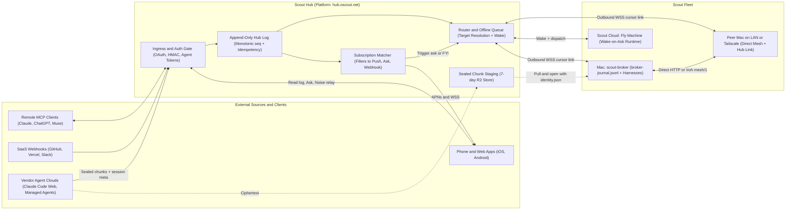

# Scout Hub: Product and Technical Specification

Status: Draft  
Date: 2026-11-26  
Layer: Hosted Platform (`hub.oscout.net`), with open protocol and client contracts in `openscout-app/scout`

> **Principle:** One place things go in, one log, subscriptions anyone can set.

Inside one machine, the local runtime broker already moves everything: its append-only journal, local deliveries, and live streams. Between machines that can reach each other on a LAN, Tailscale, or Iroh, the mesh forwards work directly. **Scout Hub** is the hosted interchange and router for everything *across* the system. It lets external tools, remote MCP clients, cloud machines, vendor sandboxes, and mobile devices get onto Scout's communication bus from anywhere, even when your Macs are asleep.

---

## 1. Promise and Who It Is For

### The promise

Put Scout Hub in front of your fleet and everything outside a single machine has one address to send to, one append-only event log to read from, and one subscription model that reaches any person or agent. You do not wire up separate relays, deploy your own Cloudflare buckets, or leave a laptop open on your desk just to keep Slack, webhooks, and remote MCP alive.

### Who it is for

1. **Individual builders working across devices and clouds.** You build on a MacBook, check progress and answer agent questions from an iPhone, start work from Claude or ChatGPT over remote MCP, run background tasks on Scout Cloud (Fly machines) or Claude Code on the web, and ship through GitHub and Vercel.
2. **Small high-trust engineering crews.** Two to ten builders and their agents coordinating across workstations, shared repositories, Slack channels, deploy pipelines, and cloud sandboxes without running enterprise message-bus infrastructure.

### What breaks today without Hub

Today, cross-machine and external reach in Scout is split across five separate mechanisms, and most of them fail as soon as a laptop sleeps:

- **Closing your laptop breaks remote MCP.** Remote MCP clients (`Claude`, `ChatGPT`, `Grok Bot`, `Muse`) connect to `https://mcp.oscout.net`, which tunnels over a single WebSocket to `scout mesh bridge` (`packages/cli/src/cli/commands/mesh-bridge.ts`, `packages/cli/src/mcp/mesh-bridge.ts`). When that Mac goes offline, callers hit `node_unreachable`. They cannot read recent activity, queue an ask for when the Mac wakes, or fall back cleanly to a cloud worker.
- **Integrations depend on one live custodian Mac.** Slack (`packages/runtime/src/integration-slack-events.ts`, `packages/runtime/src/slack-worker-supervisor.ts`) and Vercel Board (`packages/runtime/src/vercel-board/service.ts`) run supervised workers inside one local `scout-broker`. When that Mac sleeps or drops off Wi-Fi, Slack mentions go unanswered and boards stop syncing. GitHub and Vercel deploy webhooks have no durable public Scout endpoint at all.
- **Vendor cloud sessions require DIY cloud plumbing and stay on one host.** Today's `scout hub` command (`packages/cli/src/cli/commands/hub.ts`, `packages/runtime/src/hub/`) only collects transcripts from Claude Code on the web (via `integrations/hub-inbox/src/worker.ts`, a user-deployed Cloudflare Worker over R2 with manual `wrangler secret put` tokens) and Anthropic Managed Agents (`packages/runtime/src/hub/managed-agents.ts`, polled every 15 seconds with a local API key). Those sessions only appear on the one Mac running the collector, and nothing in Scout can subscribe to events from them.
- **Hosted relays are fragmented.** MCP uses `https://mcp.oscout.net`, presence rendezvous uses `https://mesh.oscout.net/v1/presence`, phone pairing uses `wss://mesh.oscout.net/v1/relay` (`packages/protocol/src/mesh.ts`), APNs uses a separate push relay (`packages/runtime/src/mobile-push.ts`), and cloud transcripts use a separate R2 Worker. Each carries its own token, config file, and failure mode.
- **Subscriptions are trapped on one machine and limited to three event shapes.** `InMemoryControlRuntime.subscribe` (`packages/runtime/src/broker.ts`), `subscribeControlEvents` (`packages/runtime/src/broker-control-events.ts`), `BrokerControlStreamService` (`packages/runtime/src/broker-control-stream-service.ts`), and `BrokerMcpEvents` (`packages/runtime/src/broker-mcp-events.ts`) only watch one local broker. `BrokerMcpEvents` exposes only `flight.completed`, `work.waiting`, and `message.created` by exact ID. Neither a person nor an agent can say: *"Notify my phone whenever a production deploy fails"* or *"Wake the `talkie` agent whenever CI fails on `main`."*

---

## 2. Concepts in Plain Words

Scout Hub has five nouns. Together they act as an interchange, a router, and a standing subscription bus.

### Sources

A **source** is anything that puts events or requests into Hub:

- **Your Scout machines:** local workstations running `scout-broker` and **Scout Cloud** machines on Fly.
- **MCP clients:** Claude, ChatGPT, Cursor, Grok Bot, Muse, or any remote MCP caller connected to Hub's MCP gateway.
- **Vendor agent clouds:** Claude Code on the web, Anthropic Managed Agents, Codex Cloud, Devin.
- **Tool webhooks:** GitHub (pushes, pull requests, check suites, reviews), Vercel (deployments, build failures), Slack (mentions, DMs, thread replies), Linear, and Sentry.

### The log

**The log** is one append-only, ordered list of `HubEvent` records for your Scout account (or crew workspace). Every accepted event gets a globally unique `id` and a monotonically increasing sequence number (`seq`).

The log holds **coordination events and external signals**: messages, asks, flight state updates, agent Feed posts and shows, cloud session lifecycle markers, and normalized webhook events (such as a failed Vercel deploy or a GitHub review comment). Following Scout's data boundary (*Observe, don't absorb* in [`docs/architecture.md`](../architecture.md#the-data-model)), the log never bulk-imports raw model turns from harness transcripts. Raw cloud transcript bytes travel as sealed sidecar chunks linked from session events.

### Routes

A **route** dispatches addressed work to the specific machine, agent, or person meant to handle it.

When an MCP client calls `ask({ projectPath: "talkie", body: "fix the build" })` or someone mentions `@scout` in a bound Slack channel, Hub resolves the target using Scout's addressing rules (project + capability, `@agent`, `target:<name>`, `session:sess.<token>`, or `--on <host>`). If the target lives on a Scout Cloud machine on Fly, Hub wakes that machine and dispatches the invocation immediately. If the target lives on a sleeping MacBook, Hub commits the accepted receipt to the log, queues the delivery for that node, and dispatches it when the Mac reconnects.

### Subscriptions

A **subscription** is a standing match rule on the log. It pairs a **filter** (what to watch for) with a **delivery action** (who gets it, and whether to notify, send an FYI, or wake an agent with an `ask`). Any authorized person or agent can create one from the CLI, MCP, phone, Mac, or web app.

### Subscribers

A **subscriber** is the person, agent, or client that receives what matches:

- **A person:** a push notification on iOS/Android, an inbox item in the Mac or web app, or a live terminal stream.
- **A Scout agent:** a project capability or named agent woken via `ask` or handed an FYI message, either on a local Mac or on a Scout Cloud Fly machine.
- **An MCP client:** receiving SEP-3415 MCP Events over webhook or SSE stream.
- **An outbound webhook:** a signed HTTP `POST` to a verified URL.

### Subscription examples

| Subscription type | Plain-words intent | Filter | What happens on match |
| --- | --- | --- | --- |
| **A keyword** | "Alert me whenever `ENOSPC` or `rollback` comes up anywhere." | `text ~ "ENOSPC" OR text ~ "rollback"` | Interrupt push to phone + Mac inbox item. |
| **A feed** | "Stream every agent Feed post and screenshot from all my Macs and Fly machines." | `kind IN (post.created, show.created)` | Live Feed timeline on phone and Mac; milestone posts (`milestone: true`) badge the app. |
| **A project** | "Follow everything happening on `talkie`." | `project = "talkie"` | Project activity feed on phone (PRs, deploys, cloud sessions, flights); interrupts on `flight.failed` or `question.asked`. |
| **A person** | "Show me whenever `person:alex` asks a question, comments on a PR, or mentions Scout in Slack." | `actor = "person:alex"` | Priority inbox stream on Mac and phone, or FYI delivery to a project orchestrator agent. |
| **A failing deploy** | "When a Vercel production deploy on `talkie` `main` fails, wake Codex on Scout Cloud to diagnose it and send me the summary." | `source = "vercel" AND kind = "deploy.failed" AND project = "talkie" AND branch = "main"` | Hub dispatches `ask` to `project:talkie` (`harness: codex`, `on: cloud`) with the deploy payload quoted as source material, then pushes the flight handle to the phone. |

---

## 3. The User's Path

### 3.1 Connecting a source

Signing in once links a machine to Hub:

```bash
scout auth login
scout hub status
```

`scout auth login` runs a browser PKCE approval flow (evolving `connectMeshBridge` in `packages/cli/src/mcp/mesh-bridge-connect.ts`), binds this machine's Ed25519 node identity (`packages/runtime/src/node-identity.ts`) to the account, saves the Hub credential in the macOS Keychain (or a mode-`0600` token file on Linux), and enables the broker's outbound Hub link under `scout-base`.

Sources connect in one step each:

- **Tool webhooks (GitHub, Vercel, Slack):**
  ```bash
  scout hub connect github --repo my-org/talkie
  scout hub connect vercel --project talkie
  scout hub connect slack
  ```
  An OAuth browser hop installs the GitHub App, Vercel integration, or Slack app (or issues a signed webhook URL `https://hub.oscout.net/v1/ingest/<source-id>` and secret for manual setup). Webhook events land on the Hub log immediately, even when every Mac is off.
- **Vendor cloud sessions (Claude Code on the web and Managed Agents):**
  ```bash
  scout hub connect claude-code ~/dev/talkie
  scout hub connect managed-agents --api-key-env ANTHROPIC_API_KEY
  ```
  Users no longer run `wrangler deploy` or create an R2 bucket. `scout hub connect claude-code` writes `.claude/scout/report.mjs`, `.claude/scout/hub.json`, and gated `.claude/settings.json` hooks (`packages/runtime/src/hub/connect.ts`), pointing the sandbox reporter at Hub's chunk endpoint with a repo-scoped write-only token (`shw_...`) and the owner's X25519 public key. For `managed-agents`, the user chooses whether the API key stays local on this Mac or is stored sealed in Hub so Hub pulls sessions while the Mac is asleep.
- **Scout Cloud machines:** Fly machines managed by Scout Cloud register with Hub automatically at boot, advertise their repositories and harnesses, sleep when idle, and wake when Hub routes work to them.

### 3.2 An MCP client connecting from anywhere

A user adds `https://hub.oscout.net/mcp` (with `https://mcp.oscout.net` kept as a permanent alias) in Claude, ChatGPT, Cursor, or Grok Bot, or runs `scout login --as muse` inside a remote VM ([`docs/integrations.md`](../integrations.md)).

1. **Identity binding:** Hub runs the MCP OAuth 2.1 consent screen (or verifies a minted `agent_token`) and pins the caller to a `McpEventPrincipal` (`packages/protocol/src/mcp-events.ts`) with an explicit Scout `agentId`.
2. **Reads that work with the laptop closed:** Tools such as `who`, `hosts`, `messages_inbox`, `broker_feed`, and `hub_log` read directly from Hub's hot projection. They show which Macs are asleep, which Scout Cloud machines are ready to wake, and what work recently completed.
3. **Asks and replies:** Calling `ask` appends an `invocation.requested` event to Hub's log and routes it:
   - **Scout Cloud target:** Hub wakes the Fly machine and streams flight updates back.
   - **Online Mac target:** Hub forwards the invocation over that Mac's open Hub link.
   - **Sleeping Mac target:** When `--on <mac>` or a Mac-only repo is requested, Hub returns an immediate durable receipt (`state: "queued"`, `reason: "host_offline_queued"`) instead of failing with `node_unreachable`. The Mac executes or surfaces the queued ask when it wakes.

### 3.3 Setting a subscription from the CLI, MCP, or an app

All surfaces write to the same `HubSubscription` API on Hub:

- **CLI:**
  ```bash
  # Push to phone when a deploy fails on talkie
  scout hub subscribe 'source:vercel kind:deploy.failed project:talkie' --notify phone

  # Wake a Scout Cloud agent when main CI fails
  scout hub subscribe 'source:github kind:check_suite.failed branch:main repo:my-org/talkie' \
    --ask --project talkie --on cloud --harness codex \
    --prompt "Inspect the failing check suite and report the root cause or open a fix PR."

  # Stream matching events live in the terminal
  scout hub tail 'project:talkie OR "auth-migration"'

  # Manage subscriptions
  scout hub subscriptions
  scout hub unsubscribe sub_01j...
  ```
- **MCP:** Connected agents call `hub_subscribe`, `hub_unsubscribe`, and `hub_subscriptions` to subscribe themselves or the operator, or call SEP-3415 `events/subscribe` (`packages/cli/src/mcp/mcp-events.ts`) to receive webhook or stream callbacks.
- **Mac and phone apps:** Tapping Subscribe on a project, agent, person, Feed filter, or search bar creates the same `HubSubscription` record, with controls for push urgency (`interrupt`, `badge`, `silent`) and quiet hours.

### 3.4 What arrives on the phone and the Mac

- **On the phone (iOS / Android):**
  - When a subscribed event or operator question lands on Hub, Hub sends an APNs/FCM push directly (folding in the push relay from `packages/runtime/src/mobile-push.ts`), with sensitive notification payloads sealed per paired phone key (`packages/runtime/src/mobile-push-seal.ts`).
  - Opening the app connects directly to Hub over HTTPS/WSS. Even with all Macs powered off, the phone shows the unified Feed (`ScoutPost` and `ScoutFeedWork` from `packages/protocol/src/posts.ts` and `packages/protocol/src/feed-work.ts`), webhook alerts, Scout Cloud flights, and open questions, and lets the user reply or start cloud asks.
  - When a paired Mac is reachable (on LAN via `packages/pairing` LAN beacon, or across networks via Hub's Noise pairing room relay), the phone attaches a direct end-to-end encrypted pairing session for host-local state such as live tmux panes and uncommitted diffs.
- **On the Mac:**
  - While awake, `scout-broker` holds one outbound WSS stream to Hub. Routed asks, replies, and relevant log events commit to `broker-journal.jsonl`, project into SQLite, and flow through `scoutd`'s Unix-socket reader so the macOS menu bar HUD, Scout.app, and `scout tui` stay current.
  - On wake after sleep, the broker sends its last durable `hubSeq` cursor to Hub, replays missed deliveries in sequence order, collects any waiting sealed cloud-session chunks into `<OPENSCOUT_HOME>/hub/`, and resumes queued work idempotently.

---

## 4. Architecture Mapped onto Real Modules

### 4.1 Baseline: what exists in the core repo today

1. **The per-machine broker (`packages/runtime/src/broker*.ts`):**
   - `packages/runtime/src/broker.ts`: `InMemoryControlRuntime` holds the in-memory `RuntimeRegistrySnapshot`, exposes `subscribe(listener: (event: ControlEvent) => void)`, handles `ControlCommand` dispatch (including `SubscribeCommand` with `kind: "stream.subscribe"` and `SubscriptionRequest` in `packages/protocol/src/transports.ts`), and plans message/invocation deliveries across ranked `AgentEndpoint` transports.
   - `packages/runtime/src/broker-daemon.ts`: the `scout-broker` composition root supervised under `launchd -> scoutd -> scout-base -> scout-broker`. It wires persistence, HTTP/SSE/tRPC routes, mesh services, `BrokerMcpEvents`, `HubCollectorService`, `ManagedAgentsPuller`, `IntegrationSlackEvents`, `BrokerVercelBoardService`, and `mobile-push.ts`.
   - `packages/runtime/src/broker-journal.ts`, `broker-journal-framing.ts`, `broker-journal-event-refs.ts`, and `broker-journal-record-contract.ts`: `FileBackedBrokerJournal` persists `BrokerJournalEntry` commits to `broker-journal.jsonl` with `fsync` durability and truncation rollback on failed writes. `broker-journal-framing.ts` prefixes rewritten journals with `journal.generation` (`version: 1`, UUID) and wraps multi-entry commits in `journal.batch` envelopes (`count <= 4096`, `bytes <= 16 MiB`, `sha256` payload digest). `broker-journal-event-refs.ts` (`ControlEventThinner` / `ControlEventHydrator`) deduplicates `flight`, `message`, and `invocation` payloads in `control.event.record` lines using `{ field, id, sha256 }` back-references. `broker-journal-record-contract.ts` (`readableJournalKinds`, `journalEntryProblem`) validates whole frames before reducers see entries, isolating corrupt frames in `BrokerQuarantine`. Compaction preserves `BrokerJournalReplayBarrier` markers so `WorkerSQLiteProjection` and `scoutd` native readers resume safely across rewrites.
   - `packages/runtime/src/broker-control-events.ts` and `broker-control-stream-service.ts`: `ControlEvent` (`packages/protocol/src/events.ts`, `OPENSCOUT_CONTROL_EVENT_VERSION = 1`) covers durable lifecycle facts (`message.posted`, `invocation.requested`, `flight.updated`, `delivery.planned`, `delivery.state.changed`, `collaboration.upserted`, etc.) plus `EPHEMERAL_CONTROL_EVENT_KINDS` (`presence.updated`, `vercel_board.handoff`, `role.slot.written`), which fan out live via `publishEphemeralControlEvent` without entering the 500-event backlog, journal, or SQLite. `BrokerControlStreamService` serves SSE firehose, per-invocation, and per-target inbox streams (`inbox.item`, `inbox.item.updated`), replaying `presenceSnapshot` on connect.
   - `packages/runtime/src/broker-delivery-store.ts`: persists `DeliveryIntent` and `DeliveryAttempt` (`packages/protocol/src/deliveries.ts`), enforcing fenced leases (`claimDelivery` bumping `metadata.leaseGeneration`, `updateDeliveryStatusIf`) across `DeliveryTransport` kinds (`local_socket`, `websocket`, `pairing_bridge`, `peer_broker`, `mcp_poll`, `webhook`, `claude_stream_json`, `codex_app_server`, `tmux`, etc. in `packages/protocol/src/common.ts`).
   - `packages/runtime/src/broker-mcp-events.ts`: broker-owned SQLite tables (`mcp_event_subscriptions`, `mcp_event_outbox`, `mcp_event_seen`, `mcp_event_source_states`) implementing SEP-3415 MCP Events (`MCP_EVENTS_PROTOCOL = "2026-07-28"`) for `flight.completed`, `work.waiting`, and `message.created`, drained over leases by `startMcpEventDeliveryWorker` (`packages/cli/src/mcp/mcp-events.ts`). (Separately, `packages/runtime/src/jetstream/index.ts` implements an opt-in loopback NATS JetStream publisher for `message.posted`, explicitly deferring cross-host subscriptions and webhooks.)
2. **The mesh and phone pairing:**
   - `packages/protocol/src/mesh.ts`: defines `OPENSCOUT_MESH_PROTOCOL_VERSION = 1`, `OPENSCOUT_IROH_MESH_ALPN = "openscout/mesh/1"`, `NodeMeshEntrypoint` (`iroh`, `cloudflare_tunnel`, `http`, `mobile_pairing`), `TrustedPeerRecord` (Ed25519 SPKI `keyId`, `observe` / `control` tiers), and three hosted URLs: `DEFAULT_OPENSCOUT_MESH_RELAY_URL` (`https://mcp.oscout.net`), `DEFAULT_OPENSCOUT_MESH_RENDEZVOUS_URL` (`https://mesh.oscout.net`), and `DEFAULT_OPENSCOUT_MOBILE_PAIRING_RELAY_URL` (`wss://mesh.oscout.net/v1/relay`).
   - `packages/cli/src/cli/commands/mesh.ts`, `mesh-bridge.ts`, `hosts.ts`, and `pair.ts`: `scout mesh` manages discovery, trust-cone enrollment, and `scout mesh bridge` (outbound WSS tunnel from local `createScoutMcpServer` in `packages/cli/src/mcp/scout-mcp.ts` to `mcp.oscout.net`, supervised by `packages/runtime/src/mesh-bridge-supervisor.ts` or `packages/mesh-extension/src/main.ts`). `scout hosts` probes live mesh machines (3s timeout) to show projects and `scout ask --on <host>` commands. `scout pair` drives `@openscout/pairing` (`packages/pairing`): on LAN, a phone discovers the host via LAN beacon and connects directly; off LAN, the host pairing controller holds a room on `wss://mesh.oscout.net/v1/relay` (`packages/runtime/src/relay-transport.ts`, `POST /resolve` by `bridgePublicKey`, Noise E2EE end-to-end) and publishes `mobile_pairing` presence (`accountRoom` + `publicKey`) via `packages/runtime/src/mesh-rendezvous.ts`.
3. **Today's `scout hub` command:**
   - `packages/cli/src/cli/commands/hub.ts` and `packages/runtime/src/hub/` (`index.ts`, `seal.ts`, `state.ts`, `mirror.ts`, `collector.ts`, `connect.ts`, `reporter-source.ts`, `managed-agents.ts`), paired with `integrations/hub-inbox/src/worker.ts` (`wrangler.jsonc`).
   - `claude-code` sandbox hooks seal transcript slices with ephemeral X25519 + HKDF-SHA256 + AES-256-GCM (`seal.ts`) and `POST` them to `/v1/inbox/chunks` on R2; `HubCollectorService` polls `/v1/inbox/pending` every 15s, opens chunks with `identity.json`, appends byte-ordered lines via `mirror.ts`, and deletes collected keys. `ManagedAgentsPuller` polls Anthropic's `beta.sessions` API every 15s into `<OPENSCOUT_HOME>/hub/managed-agents/`.

### 4.2 How hosted Hub relates to each machine's broker

Hub uses **authority-preserving federation** (outbound cursor sync + store-and-forward routing), rather than a stateless relay or a full cloud mirror of local broker databases:

- **Stateless relay is too weak:** pure WebSocket rooms (`relay-transport.ts`, `mesh-bridge.ts`) lose webhooks, remote MCP reads, and subscriptions whenever the host disconnects.
- **Full broker mirroring is too invasive:** shipping every local `broker-journal.jsonl` entry, local socket heartbeat, and harness transcript to the cloud would violate [`docs/public-source-boundary.md`](../public-source-boundary.md), bloat storage, and put cloud latency in front of local work.
- **Authority-preserving federation:**
  1. **Local authority stays local.** Each `scout-broker` remains the sole canonical writer of its `broker-journal.jsonl` and SQLite projections. Same-Mac work never waits on Hub.
  2. **Direct mesh stays direct.** When peers can dial each other over LAN, Tailscale, or Iroh (`openscout/mesh/1`), `PeerDeliveryWorker` (`packages/runtime/src/peer-delivery.ts`) and `BrokerMeshForwardingService` (`packages/runtime/src/broker-mesh-forwarding-service.ts`) forward bundles directly. Hub provides node presence discovery and serves as a store-and-forward fallback `DeliveryTransport` (`"hub"`) when direct dial fails or the target host is asleep.
  3. **Selective outbound outbox.** Each connected broker runs `HubOutboxService`, tailing `FileBackedBrokerJournal` via `BrokerJournalReplayBarrier` (just like `JetStreamJournalPublisher` in `packages/runtime/src/jetstream/index.ts`) to publish cross-system facts: node/agent cards, public/workspace channel messages, cross-node flights, operator questions, and Feed posts/shows. `EPHEMERAL_CONTROL_EVENT_KINDS` never enter Hub's durable log; Hub keeps only an in-memory latest-presence map per node/agent.
  4. **Inbound cursor stream.** Each broker subscribes to Hub over one persistent WSS connection starting from its last acked `hubSeq`, committing inbound asks, replies, peer forwards, and host-targeted subscription deliveries into `BrokerDeliveryStore`.



### 4.3 Event identity and ordering

Every record on Hub's log uses one `HubEvent` envelope:

```ts
export interface HubEvent {
  /** Globally unique ULID/UUIDv7 minted on creation. */
  id: ScoutId;
  /** Monotonic per-workspace sequence assigned by Hub on commit (1, 2, 3...). */
  seq: number;
  /** Producer idempotency key, e.g. "github:delivery:<guid>" or "node:<nodeId>:evt:<id>". */
  idempotencyKey: string;
  v: 1;
  /** "broker" | "mcp" | "scout-cloud" | "claude-code" | "managed-agents" | "github" | "vercel" | "slack" | "webhook" */
  source: HubSourceKind;
  /** Configured source instance id or origin nodeId. */
  sourceId: string;
  /** Domain event kind, e.g. "message.posted", "flight.updated", "post.created", "deploy.failed", "session.chunk_ready". */
  kind: string;
  /** Hub commit time (epoch ms) and optional producer timestamp. */
  ts: number;
  originTs?: number;
  /** Unsealed routing and filter facets. */
  facets: {
    actorId?: ScoutId;
    nodeId?: ScoutId;
    project?: string;
    repo?: string;
    branch?: string;
    conversationId?: ScoutId;
    invocationId?: ScoutId;
    flightId?: ScoutId;
    workId?: ScoutId;
    sessionHandle?: string;
    labels?: string[];
    severity?: "info" | "warn" | "error";
  };
  body:
    | { encoding: "json"; summary: string; data: Record<string, unknown> }
    | { encoding: "sealed"; alg: "x25519-aes-256-gcm-v1"; recipientKeyId: string; ciphertextRef: string; byteLength: number };
}
```

- **Ordering:** `seq` gives a strict total order on Hub's log per workspace. Phones, MCP streams, subscription workers, and reconnecting brokers track progress with a single integer `lastSeq` cursor.
- **Idempotency:** Hub deduplicates `(workspaceId, idempotencyKey)` across an 8-day rolling window (matching `mcp_event_seen` in `packages/runtime/src/broker-mcp-events.ts`). Retried webhooks or replayed broker outbox batches return the existing `seq` without duplicating deliveries.
- **Causal metadata:** Offline peers preserve `originTs`, `conversationId`, `invocationId`, `flightId`, and `traceparent`; Hub orders their events by commit arrival without claiming cross-host clock synchronization.

### 4.4 What Hub stores vs what stays on your machines

| Data | Stored on Hub (Platform) | Stored on Your Machines (`~/.openscout`) |
| --- | --- | --- |
| **Coordination log** | Bounded rolling window of `HubEvent` records (24h–90d by tier) indexed by `seq` | Canonical `broker-journal.jsonl`, `control-plane.sqlite`, and immutable `history/` partitions |
| **Raw harness transcripts** | **Never stored in plaintext.** Only temporary sealed chunks in R2 (7-day TTL) from cloud sandboxes | Canonical `.claude`, `.codex`, and `<OPENSCOUT_HOME>/hub/` JSONL files (`Observe, don't absorb`) |
| **Source configs & secrets** | Webhook endpoints, OAuth installations, KMS-encrypted signing secrets, optional cloud-pull keys | Repo `.claude/scout/hub.json` write tokens; host-only API keys when local pull is chosen |
| **Routing & presence** | Enrolled node public keys (`TrustedPeerRecord`), live presence, Scout Cloud Fly machine IDs, offline delivery queues | Local `AgentEndpoint` table (`tmux`, `codex_app_server`, `claude_stream_json`), PIDs, worktrees, route aliases |
| **Subscriptions** | Workspace `HubSubscription` records, subscriber `seq` cursors, webhook outbox & retry leases | In-process `ControlRuntime.subscribe` callbacks, local SSE streams, `scoutd` Unix-socket HUD projection |
| **Mobile push & pairing** | Device APNs/FCM tokens, per-device sealed push notifications, opaque Noise pairing rooms | Canonical pairing trust owner (`packages/runtime/src/pairing-security/trust-owner.ts`), Noise private keys |
| **Code & artifacts** | Explicitly published `ScoutPostFile` ("shows") with retention TTL | Git checkouts, worktrees, uncommitted diffs, local build outputs |

### 4.5 Offline machines, wake, and replay

1. **Mac goes offline while working:** `scout-broker` commits locally to `broker-journal.jsonl` as usual. `HubOutboxService` holds its `BrokerJournalReplayBarrier` cursor and flushes new cross-system events in batch order once connectivity returns.
2. **Work routed to an offline Mac:** Hub writes the invocation to the log, creates a queued Hub delivery (`status: "accepted"`, `targetNodeId`), and returns an actionable `queued` receipt (never a silent hang). When the Mac reconnects, it presents `lastAckedSeq`, receives missed deliveries in `seq` order, records each via `BrokerRequestReceipts` (`packages/runtime/src/broker-request-receipts.ts`) and `BrokerDeliveryStore` **before** acknowledging `seq` to Hub, and executes once.
3. **Work routed to a sleeping Scout Cloud machine:** Hub calls Fly's wake API for the target node, holds the delivery lease for 1–3 seconds while `scout-broker` boots and opens its Hub link, and dispatches the invocation immediately.

### 4.6 How `scout hub` today and the hosted MCP gateway fold in

- **Today's `scout hub` (`packages/cli/src/cli/commands/hub.ts`, `packages/runtime/src/hub/`):** Folds in as two built-in **Hub Sources** (`claude-code` and `managed-agents`). Sandbox reporters continue sealing transcript chunks with `seal.ts` (`0x01` X25519 + AES-256-GCM envelope), posting to Hub's `/v1/sources/claude-code/chunks` instead of a user-managed Cloudflare Worker. Storing a chunk appends a `session.chunk_ready` `HubEvent` on the log, waking `HubCollectorService` over the live Hub link instead of waiting on 15-second blind polling, while exposing active cloud session metadata to iOS and subscriptions immediately. `integrations/hub-inbox` stays in the repo as the self-hosted single-inbox reference worker.
- **Hosted MCP gateway (`mcp.oscout.net`) and mesh relays (`mesh.oscout.net`):** Consolidate into Hub (`hub.oscout.net`, keeping `mcp.oscout.net` and `mesh.oscout.net` as permanent DNS/route aliases). `scout-broker`'s single Hub link replaces both the separate `scout mesh bridge` child process (`packages/runtime/src/mesh-bridge-supervisor.ts`) and the periodic HTTP rendezvous publisher (`packages/runtime/src/mesh-rendezvous.ts`). Hub terminates MCP HTTP/SSE and SEP-3415 `events/subscribe` at the edge, answering workspace reads and subscription management directly and forwarding host-specific tool calls over the target node's Hub link.
- **Scout Cloud (`scout-cloud`):** Scout Cloud's hosted relay and MCP gateway *is* Hub, and Fly machines running Scout act as both Hub event sources and wakeable route/subscription targets.

### 4.7 Files in `openscout-app/scout` that would change

- **Protocol (`packages/protocol/src/`):**
  - Add `packages/protocol/src/hub.ts` (re-exported from `packages/protocol/src/index.ts`): `HubEvent`, `HubSourceKind`, `HubSourceConfig`, `HubFilter`, `HubSubscription`, `HubSubscriberTarget`, `HubLinkEnvelope`, `HubCursor`.
  - Update `packages/protocol/src/mesh.ts`: add `DEFAULT_OPENSCOUT_HUB_URL = "https://hub.oscout.net"` and `HubMeshEntrypoint` (`kind: "hub"`), keeping `mcp.oscout.net` and `mesh.oscout.net` constants as compatibility aliases.
  - Update `packages/protocol/src/common.ts`: add `"hub"` to `DeliveryTransport` and `"subscription"` to `DeliveryReason`.
  - Update `packages/protocol/src/events.ts`, `mcp-events.ts`, and `mcp-core-tools.ts`: define `ControlEvent` -> `HubEvent` projection helpers and add `hub_log`, `hub_subscribe`, `hub_unsubscribe`, and `hub_subscriptions` core MCP tool schemas.
- **Runtime (`packages/runtime/src/`):**
  - Add `packages/runtime/src/hub/link.ts` and `packages/runtime/src/hub/outbox.ts`: persistent outbound WSS Hub client (`seq` replay, inbound delivery handoff, MCP RPC multiplex) and barrier-safe journal publisher.
  - Update `packages/runtime/src/hub/index.ts`, `state.ts`, `collector.ts`, `connect.ts`, `managed-agents.ts`, and `seal.ts`: default chunk ingress to Hub when authenticated, trigger `collectOnce()` on `session.chunk_ready` events, and support per-repo `shw_` tokens.
  - Update `packages/runtime/src/broker-daemon.ts` and `peer-delivery.ts`: wire `BrokerHubLinkService` and `HubOutboxService` into broker startup, and add `"hub"` store-and-forward fallback when direct peer entrypoints fail.
  - Update `packages/runtime/src/mesh-bridge-supervisor.ts`, `mesh-bridge-config.ts`, `mesh-rendezvous.ts`, `open-scout-network.ts`, and `broker-mcp-events.ts`: route presence and remote MCP over the unified Hub link while preserving local `BrokerMcpEvents` for loopback/offline use.
- **CLI and MCP (`packages/cli/src/`):**
  - Update `packages/cli/src/cli/commands/hub.ts` and `packages/cli/src/cli/registry.ts`: add `subscribe`, `unsubscribe`, `subscriptions`, `tail`, `log`, and `sources` subcommands alongside `status`, `connect`, `disconnect`, `collect`, and `init`.
  - Update `packages/cli/src/mcp/scout-mcp.ts`, `packages/cli/src/mcp/mesh-bridge.ts`, `packages/cli/src/mcp/mcp-events.ts`, and `packages/mesh-extension/src/main.ts`: register Hub MCP tools and speak the unified Hub link envelope.

---

## 5. Security and Trust

Scout Hub keeps Scout's explicit trust model ([`docs/architecture.md`](../architecture.md#principles)): cryptographic identity and least-surprise permissions for trusted personal and small-team fleets, without claiming untrusted multi-tenant enterprise compliance.

### 5.1 What Hub can read: sealed vs readable events

1. **Sealed payloads (Hub cannot read plaintext):**
   - **Vendor cloud transcript chunks** (`packages/runtime/src/hub/seal.ts`, X25519 + HKDF-SHA256 + AES-256-GCM), **paired phone terminal/diff streams** (`packages/pairing` Noise bridge), **sealed push notifications** (`packages/runtime/src/mobile-push-seal.ts`), and **private DMs or attachments marked `sealed`**.
   - Hub sees only unsealed `HubEvent.facets` (`source`, `kind`, `project`, `repo`, `actorId`, `targetNodeId`, `sessionHandle`, timestamps, byte size) and opaque ciphertext.
2. **Readable coordination envelopes (TLS in transit, encrypted at rest on Hub):**
   - **Third-party webhooks** (GitHub, Vercel, Slack, Linear—already sent in plaintext HTTPS by those vendors), **public/workspace channel messages**, **Feed posts** (`ScoutPost`), **flight status summaries**, and **remote MCP tool calls** routed through Hub.

#### The keyword subscription tradeoff on sealed content

Hub can only match server-side keywords (`text ~ "ENOSPC"`) against readable fields:

- **Structured facet filters always work on Hub**, even for sealed events (`source:claude-code project:talkie kind:session.ended`), because facets live in the unsealed envelope header.
- **Sealing is never weakened for keyword matching.** Hub never holds private sealing keys. Server-side keyword filters match readable coordination events (webhooks, Feed posts, flight summaries, workspace channels). Full-text search over sealed transcripts stays local on the owner's machines (`scout search`). Where useful, a sandbox reporter may emit explicit coarse facets (`severity: "error"`, exit code) without exposing transcript text.

### 5.2 Auth for sources and subscribers

- **Brokers and Cloud nodes:** Authenticate with account-issued `oshb_` / `osbr_` credentials bound to each node's Ed25519 key (`packages/runtime/src/node-identity.ts`), stored in macOS Keychain or mode-`0600` files and never printed to terminal stdout.
- **Webhook sources:** Verified at Hub ingress before log commit using provider HMACs (`X-Hub-Signature-256`, `x-vercel-signature`, `X-Slack-Signature` with 5-minute replay guard, `standardwebhooks`). Cloud sandbox reporters upgrade from single-bucket `WRITE_TOKEN` (`integrations/hub-inbox`) to **per-repo revocable write-only tokens** (`shw_<id>_<secret>`) bound to one repo `label`.
- **Untrusted content framing:** All external webhook and third-party chat text is tagged `untrustedExternalContent: true` and quoted as observed source material when delivered to an agent (matching `BrokerVercelBoardService.dispatch` in `packages/runtime/src/vercel-board/service.ts` and `BrokerMcpEvents`), never injected as raw operator instructions.
- **MCP clients and subscribers:** Authenticated via OAuth 2.1 + PKCE or scoped `agent_token` (`McpEventPrincipal`); gateway-authenticated identity always overrides tool-supplied sender fields. Subscriptions verify read access both when created and before each delivery (matching `BrokerMcpEvents.authorized` / `deliveryAllowed`), verify external webhook URLs via challenge-response (`packages/runtime/src/mcp-event-webhook.ts`), sign outbound payloads with dual-secret rotation headers, and emit a data-free `terminated` frame when access is revoked.

### 5.3 Abuse limits

- **Ingress rate & size caps:** 60 req/min burst (300/min sustained) per source token/IP (`429` + `Retry-After`); 256 KiB max JSON `HubEvent` envelope; 32 MiB max sealed chunk (`DEFAULT_MAX_CHUNK_BYTES` in `integrations/hub-inbox/src/worker.ts`).
- **Subscription & outbox bounds:** Max 100 active subscriptions per principal (500 per workspace); max 1,000 pending deliveries per subscription with 7 exponential-backoff retries before marking a dead subscriber `degraded` without slowing the log.
- **Wake-storm circuit breaker:** Subscription-triggered `ask` dispatches stamp `triggerDepth` (rejected above depth 3) and enforce a per-subscription wake budget (default max 5 agent wakes per 10 minutes), halting self-triggering agent loops and notifying the operator once.

---

## 6. Open Source vs Paid

Scout Hub aligns with the three-layer ownership boundary in [`docs/public-source-boundary.md`](../public-source-boundary.md):

| Layer | Repository & License | What lives there for Hub |
| --- | --- | --- |
| **Public core** | `openscout-app/scout` (Apache-2.0) | `@openscout/protocol` (`hub.ts` wire types), `@openscout/runtime` (local broker, direct mesh, outbound `hub/link.ts`, `hub/seal.ts`, source connectors), `@openscout/scout` (`scout hub` CLI, local `scout mcp`), and standalone `integrations/hub-inbox` + `relay-transport.ts`. |
| **Apps** | Private apps repo | Mac, iOS, Android, and web UIs for the unified Feed, Hub log, source OAuth setup, and visual subscription builder. |
| **Hosted Platform** | Private platform repo | `hub.oscout.net`: multi-tenant webhook ingress, hosted MCP OAuth gateway, durable `seq` log, subscription matcher, offline host queues, APNs/FCM push service, and Scout Cloud Fly wake controller. |

- **Local-first invariant preserved:** Core installs, builds, tests, and runs locally or over LAN/Tailscale/Iroh with zero Platform account and zero outbound calls to `oscout.net`.
- **Paid packaging:** A **Free** personal tier covers remote MCP reach, mobile pairing/push, 24-hour Hub log replay, up to 2 external sources, and 5 push/inbox subscriptions. **Pro** (individual) and **Crew** (shared team) paid tiers unlock 30–90 day log retention, unlimited GitHub/Vercel/Slack/Linear sources, cloud-pulled vendor sessions, **wake-agent-on-subscription** automation, higher event volume, and shared crew channels alongside Scout Cloud compute.

---

## 7. MVP, Next Phases, and Non-Goals

### MVP (Ships in 3–4 weeks)

1. **Single Hub front door (`hub.oscout.net`, aliasing `mcp.oscout.net` and `mesh.oscout.net`):** One append-only `hub_events` log (`seq`, `idempotencyKey`, `facets`, `body`, 7-day retention) unifying MCP gateway, node presence, Noise pairing rooms, and APNs push behind `scout auth login`.
2. **Unified Broker Hub Link (`packages/runtime/src/hub/link.ts` + `outbox.ts`):** Replaces the standalone `scout mesh bridge` process and HTTP rendezvous loop; replays missed `seq` items on Mac wake and queues invocations when a target Mac is offline.
3. **Four initial sources:** (a) Remote MCP gateway, (b) GitHub + Vercel signed webhooks, (c) `claude-code` sealed cloud session chunks hosted on Hub R2 (no user Wrangler deploy), and (d) local + Scout Cloud broker events (`flight.updated`, `question`, `post.created`, `show.created`).
4. **Initial subscriptions & CLI:** Facet + substring filters (`source`, `kind`, `project`, `repo`, `branch`, `actor`, `text`) delivering to **phone push/inbox**, **Scout agent `ask`/FYI** (with loop guard), and **`scout hub tail` / `scout hub subscribe`**.

### Phase 2 (Weeks 5–10)

- Hosted Slack Event Subscriptions and Linear/Sentry webhook sources (removing single-Mac Socket Mode custody as a failure point).
- Cloud-hosted `ManagedAgentsPuller` (and Codex Cloud / Devin pullers) running inside Hub so vendor sessions appear on mobile while all Macs are off.
- Mac and iOS visual Subscription Builder, batch digests, quiet hours, and Scout Cloud wake-spend limits.
- Full SEP-3415 `events/subscribe` webhook delivery directly from Hub for any `HubFilter`.

### Phase 3 (Later)

- Shared **Crew** Hub workspaces (multi-operator channels, shared project/deploy subscriptions, team roster routing).
- Windowed/compound triggers (*"3 errors in 10m"*, *"PR approved + CI green"*).
- Customer-owned S3/R2 archive export.

### Non-Goals

- Storing raw local `.claude` or `.codex` transcripts in the cloud (*Observe, don't absorb*).
- Routing same-Mac or direct-LAN peer traffic through Hub.
- Global linearizable consensus across partitioned networks.
- Generic non-Scout ETL/Zapier workflows or untrusted enterprise compliance claims.

---

## 8. Open Decisions for Art

### 1. Does Hub see plaintext?

- **Option A: Strict E2EE everywhere except routing facets.** Seal all broker events and edge-encrypt incoming SaaS webhooks to the owner's public key immediately at ingress. *(Breaks server-side keyword matching and prevents remote MCP clients like Claude/ChatGPT from reading `messages_inbox` or `broker_feed` when your Mac is asleep.)*
- **Option B: Tiered ("readable coordination, sealed transcripts & paired streams") with per-conversation `sealed` opt-in.** Keep raw cloud transcripts (`seal.ts`), phone pairing streams (`packages/pairing`), and device push payloads E2EE; keep coordination events (webhooks, Feed posts, workspace channels, flight summaries) readable by Hub and encrypted at rest.
- **Option C: Plaintext for everything on Hub, including vendor cloud transcripts.** *(Drops the privacy property already shipped in `packages/runtime/src/hub/seal.ts`.)*
- **Recommendation:** **Option B.** It preserves E2EE on raw code and transcripts while letting remote MCP, keyword subscriptions, and zero-Mac phone feeds work when laptops are closed.

### 2. What is the subscription filter language?

- **Option A: Small typed JSON AST in `@openscout/protocol` + Gmail/GitHub-style query string (`source:vercel kind:deploy.failed project:talkie "timeout"`).** Compiles deterministically to exact facet checks, `IN` lists, `AND`/`OR`/`NOT`, and case-insensitive substring/token matches.
- **Option B: Structured JSON/CLI flags only (no query string).** *(Awkward in CLI, search bars, and `OR` queries.)*
- **Option C: Arbitrary regexes, SQL/CEL, or LLM-judged natural-language filters on the bus.** *(Unpredictable cost, latency, and ReDoS risk on hot ingress.)*
- **Recommendation:** **Option A.** Keep Hub matching deterministic and sub-millisecond; wake an agent when semantic judgment is needed.

### 3. Does the CLI keep `scout hub` for both the hosted service and connecting sources?

- **Option A: Unify everything under `scout hub`.** `scout hub [status]`, `scout hub connect <claude-code|managed-agents|github|vercel|slack>`, `scout hub subscribe|unsubscribe|subscriptions`, and `scout hub tail|log`, while folding `scout mesh bridge` into the automatic Hub link (kept as a deprecated alias).
- **Option B: Move source connectors to `scout sources` and reserve `scout hub` for the hosted log and subscriptions.** *(Breaks existing `scout hub connect` muscle memory and splits one mental model across two verbs.)*
- **Option C: Keep `scout hub` for vendor transcripts and name the new command `scout bus` or `scout relay`.** *(Fights the product name **Scout Hub**.)*
- **Recommendation:** **Option A.** Cloud session connectors *are* Hub sources now, so `scout hub connect <source>` and `scout hub subscribe <filter>` belong under one command, with `--inbox <url>` kept for self-hosted `integrations/hub-inbox`.

### 4. Is Hub self-hostable or hosted-only?

- **Option A: Hosted-only in Platform, with open wire contracts in `@openscout/protocol` and standalone OSS micro-workers (`integrations/hub-inbox`, `relay-transport.ts`).** Keep `OPENSCOUT_HUB_URL` configurable for dev/staging, but do not ship or support a self-hosted full Hub server.
- **Option B: Open-source the full Hub server in `openscout-app/scout` from day one.** *(Doubles maintenance across GitHub/Slack OAuth apps, APNs keys, and DB ops, and erodes the Platform boundary in [`docs/public-source-boundary.md`](../public-source-boundary.md).)*
- **Option C: Hosted-only now; ship a stripped-down self-hostable container (`scout-hub-lite`) later only if VPC/team demand justifies it.**
- **Recommendation:** **Option A now (preserving Option C later via `OPENSCOUT_HUB_URL`).**

### 5. Where do Slack and Vercel Board adapters run once Hub launches?

- **Option A: Hub ingress only; remove local `SlackWorkerSupervisor` and `BrokerVercelBoardService`.** *(Breaks local-only open-source users without a Hub account.)*
- **Option B: Host-supervised on one Mac only, publishing summaries to Hub.** *(Still dies whenever that Mac sleeps.)*
- **Option C: Hub webhook ingress by default when signed in; host-supervised mode retained for local-only OSS users.**
- **Recommendation:** **Option C.** Hosted users get 24/7 responsiveness with laptops shut, and local-only open-source users keep full functionality.
